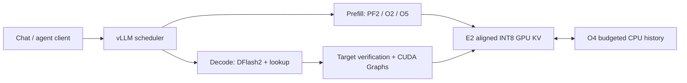

# QwenRelay

**Run Qwen3.8-27B on one, two or four RTX 3090s — with DFlash2, long-context prefill and reusable conversation caches.**

[简体中文](README.zh-CN.md) · [Quick start](#quick-start) · [Performance](#performance) · [Launch options](#launch-options) · [Documentation](#documentation)

QwenRelay focuses on local coding assistants, multi-turn agents and small concurrent inference services. It combines a pinned [HyperQwen](https://github.com/syv-ai/HyperQwen) / vLLM stack with INT8 KV storage, budgeted CPU history caching, prefill optimizations and CUDA Graph fixes for speculative decoding.

Start with **one RTX 3090 24 GB**. The launcher defaults to **TP1 + AutoRound-fast + DFlash2**, with four active request slots. `--tp 2` and `--tp 4` select EfficientThink and the corresponding resource and optimization defaults. Concurrency, context, draft depth and cache budgets can all be overridden.

> **Source candidate status:** historical TP1, TP2 and TP4 implementations have GPU evidence at the scopes described below. The current unified source has passed offline reconstruction and CPU checks. Fresh installation, complete public model preparation, Docker startup and GPU regression of this merged version remain to be qualified. See [validation status](#validation-status).

## Why QwenRelay

A coding session repeatedly sends a growing history. Several users can mix long prompts with ongoing generation. QwenRelay works on the memory and execution paths that matter to those workloads:

| Capability | What it does |
|---|---|
| **DFlash2 speculative decoding** | Uses a separate draft model and target verification, with context-lookup-assisted proposals and split-KV verification attention enabled by the launcher. |
| **Long-context prefill** | Reuses INT8 KV during eligible prefill work and provides bounded paths for single-request and mixed prefill batches. |
| **Conversation cache reuse** | Combines GPU prefix caching with budgeted CPU storage for full-attention KV, recurrent state and draft history. |
| **Small concurrent batches** | Defaults to four running requests; sizes verification scratch and CUDA Graph coverage from the chosen concurrency and draft depth. |
| **One entry point for TP1 / TP2 / TP4** | Selects matching weights, GPU layout, cache budgets and draft configuration, while allowing explicit numerical overrides. |
| **OpenAI-compatible serving** | Provides chat completions and SSE streaming, with Qwen reasoning and tool-call parsers configured. |
| **Traceable source and assets** | Pins upstream commits and model revisions, checks final file hashes and preserves third-party attribution. |

The current launcher targets **native Linux and RTX 3090 24 GB cards**, with text-only Qwen3.8-27B checkpoints from the supplied locks. Other GPUs, arbitrary checkpoints and vision are outside these launch profiles. Higher client queue depths are possible; the default scheduler still runs at most four requests at once.

## Performance

These are **historical paired comparisons**, not measurements of the latest merged checkout or a leaderboard against today's upstream releases. Within each comparison, H is the recorded HyperQwen reference and F is the QwenRelay candidate using the same model assets and hardware. Each arm ran one warm round and three formal rounds; the tables show formal-round medians.

### Single RTX 3090 · TP1 · AutoRound-fast

Same GPU, 6 GiB GPU KV, 32 GiB CPU KV, four active slots and DFlash depth 4. The 2026-10-19/20 comparison includes the DFlash environment settings and scratch-capacity correction in **both** H and F.

| Workload | Metric | H | F | Change |
|---|---|---:|---:|---:|
| Real questions, C1, default sampling | C / mean TPOT, tok/s | 124.64 | **128.72** | +3.27% |
| Real questions, C4, default sampling | C / mean TPOT, tok/s | 162.09 | **324.65** | +100.29% |
| Real questions, C4, temperature 0 | C / mean TPOT, tok/s | 164.17 | **330.76** | +101.48% |
| 64K input, C1 prefill | Input tok/s | 562.93 | **1,041.40** | +85.00% |
| 100K input, C1 prefill | Input tok/s | 423.01 | **925.88** | +118.88% |
| 128K input, C1 generation | C / mean TPOT, tok/s | 91.88 | **138.68** | +50.95% |

F had better numerical medians in 29 of 30 cases; T0 C2 was −1.46%. The host had shared CPU/memory resources. The run did not repeat a quality battery or independent cache-restore acceptance. [Full 30-case summary and scope](docs/qwenrelay-tp1-benchmarks.md).

### Two RTX 3090s · TP2 · EfficientThink

The 2026-10-17/18 comparison used the same EfficientThink mixed-AWQ target, DFlash2 draft, native libraries and cache byte budgets in both arms.

| Workload | Metric | H | F | Change |
|---|---|---:|---:|---:|
| Real questions, C4, default sampling | C / mean TPOT, tok/s | 107.50 | **360.11** | +235.00% |
| Real questions, C4, temperature 0 | C / mean TPOT, tok/s | 113.19 | **374.92** | +231.22% |
| 64K input, C1 prefill | Input tok/s | 887.74 | **1,418.95** | +59.84% |
| 100K input, C1 prefill | Input tok/s | 698.48 | **1,308.30** | +87.31% |

The original 22-case matrix also includes regressions: T0 C2 −2.63% and default-sampling C1 −1.85%. The additional 1K C1 synthetic decode result is highly variable. [All TP2 results, ranges and machine-readable data](docs/qwenrelay-benchmarks.md).

**Read the units with the result.** `C / mean TPOT` measures request-level generation timing; it is not total output throughput. For example, TP2 default-sampling C4 aggregate output throughput was **101.78 → 300.05 tok/s**, including the full benchmark duration. Prefill uses input tokens divided by complete case time. C8/C16 can include queuing under a four-slot scheduler.

TP1 and TP2 use different checkpoints and machines, so their rows do not measure GPU scaling. TP4 has separate [numerical and serving checks](docs/qwenrelay-tp4-validation.md), [communication measurements](docs/qwenrelay-tp4-communication-tuning.md) and [greedy-output investigation](docs/qwenrelay-tp4-greedy-correctness.md); those limited runs are not a three-round TP4 H/F matrix.

## Choose a GPU profile

`TP` means tensor parallelism: one model is partitioned across the selected cards. TP2 and TP4 are not two or four independent API replicas.

| Setting | TP1 — default | TP2 | TP4 |
|---|---|---|---|
| GPUs | 1 × RTX 3090 24 GB | 2 × RTX 3090 24 GB | 4 × RTX 3090 24 GB |
| Primary model | AutoRound-fast | EfficientThink SimPO mixed AWQ | Same as TP2 |
| Profile | `single-3090` | `dual-3090` | `quad-3090` |
| Context ceiling, input + output | 132,096 tokens | 262,144 tokens | 262,144 tokens |
| GPU KV budget **per card** | 6 GiB | 11,184,101,204 bytes (≈10.42 GiB) | 14 GiB |
| CPU KV budget **per TP group** | 32 GiB | 32 GiB | 32 GiB |
| Default devices | `0` | `0,1` | `0,1,2,3` |

All three use **DFlash2 W4A16, depth 4, four active sequences, a 2,048-token scheduler budget, BF16 activations, INT8 per-token/head KV and FP16 recurrent state**. Draft TP follows target TP.

The context ceiling is a per-request limit. Four slots do not guarantee that four maximum-length conversations fit concurrently. Weight memory, KV pools, scratch and CUDA Graphs all consume resources. Multi-GPU performance also depends on PCIe/NVLink topology, usable P2P, CPU locality and cooling; increasing TP does not guarantee lower latency.

## Quick start

### 1. Prepare the host

| Requirement | Target / planning allowance |
|---|---|
| OS and Python | Native Linux x86-64, Python 3.12 with `venv` and development headers |
| GPU | One, two or four RTX 3090 24 GB cards |
| Driver | Compatible with CUDA 13.0 userspace; recorded runs used NVIDIA 580.126.20 |
| Runtime pins | vLLM 0.31.0, PyTorch 2.13.0, Triton 3.7.1; [direct dependencies](requirements-qwenrelay.txt) |
| Build tools | Git, GNU `patch`, C/C++ compiler, curl and CA certificates |
| Host RAM | Plan for at least 64 GiB available with the default 32 GiB CPU cache; allow more for compilation |
| Storage | Allow roughly 60 GiB for one model route, runtime, source and caches; keep extra space for both targets or retained preparation files |
| Docker only | Docker Compose and a working NVIDIA Container Toolkit |

RAM/disk figures are planning allowances, not measured minimums. macOS can inspect source and run offline checks; it cannot serve these CUDA profiles. Full setup details are in the [installation guide](docs/qwenrelay-install.md).

### 2. Install the pinned runtime

```bash
git clone https://github.com/Stanley2Data/QwenRelay.git
cd QwenRelay
bash scripts/install-qwenrelay.sh
```

The installer creates a **new `.venv`**, installs dependencies, fetches the pinned vLLM source and reconstructs the QwenRelay source tree. It refuses an existing environment. Model download and server startup are separate steps.

### 3. Prepare the model

```bash
# Default: TP1 AutoRound-fast target and shared DFlash2 draft.
.venv/bin/python scripts/qwenrelay.py fetch-models --root ./models

# If using TP2 or TP4, fetch EfficientThink instead; both share these assets.
.venv/bin/python scripts/qwenrelay.py fetch-models --tp 2 --root ./models
```

Run the command for the profile you intend to use. TP1 assembles pinned public HyperQwen inputs and quantizes the embedding on CPU; each final file must match the asset lock. Existing model directories are verified rather than rewritten. See [model sources](#model-sources) for the exact repositories.

### 4. Create a key and start

```bash
# Create once, from the repository directory.
umask 077
.venv/bin/python -c 'import secrets; print(secrets.token_urlsafe(32))' > api_key.txt

# Inspect configuration without reading the key, loading models or probing CUDA.
bash scripts/start-qwenrelay.sh --tp 1 --devices 0 --dry-run

# Start the server in the foreground.
bash scripts/start-qwenrelay.sh --tp 1 --devices 0
```

For a different card count, use one of these launch commands after preparing its assets:

```bash
bash scripts/start-qwenrelay.sh --tp 2 --devices 0,1
bash scripts/start-qwenrelay.sh --tp 4 --devices 0,1,2,3
```

Real startup checks model hashes, runtime identities and visible GPUs before serving. Hashing large files and first-run compilation can take time. A successful `--dry-run` only confirms the launch plan.

### 5. Send a request

In another terminal, from the repository directory:

```bash
export QWENRELAY_API_KEY="$(cat api_key.txt)"

curl --fail-with-body http://127.0.0.1:18020/v1/models \
  -H "Authorization: Bearer $QWENRELAY_API_KEY"

curl --fail-with-body http://127.0.0.1:18020/v1/chat/completions \
  -H "Authorization: Bearer $QWENRELAY_API_KEY" \
  -H 'Content-Type: application/json' \
  -d '{
    "model": "qwenrelay",
    "messages": [{"role": "user", "content": "Explain prefill and decode in three sentences."}],
    "max_tokens": 256,
    "temperature": 0.6,
    "chat_template_kwargs": {"enable_thinking": false}
  }'
```

This short example disables thinking so its small output budget is available for the answer. To stream, add `"stream": true` to the JSON and `-N` to `curl`.

## Connect clients and agents

| Client setting | Value |
|---|---|
| Provider / API | OpenAI-compatible Chat Completions |
| Base URL | `http://127.0.0.1:18020/v1` |
| Model ID | `qwenrelay` |
| API key | Contents of `api_key.txt` |
| Context limit | Match your effective `--max-model-len`; leave room for output |

Python clients can use the `openai` package in their client environment:

```python
from pathlib import Path
from openai import OpenAI

client = OpenAI(
    base_url="http://127.0.0.1:18020/v1",
    api_key=Path("api_key.txt").read_text().strip(),
    timeout=600.0,
)
response = client.chat.completions.create(
    model="qwenrelay",
    messages=[{"role": "user", "content": "Write a Python function that merges two sorted lists."}],
    max_tokens=512,
    extra_body={"chat_template_kwargs": {"enable_thinking": False}},
)
print(response.choices[0].message.content)
```

The profiles enable `qwen3` reasoning parsing, `qwen3_coder` tool-call parsing and automatic tool choice. Send ordinary Chat Completions `tools` / `tool_choice` fields from your client. The client executes a returned tool call and sends the tool result in the next turn. End-to-end compatibility with each agent and its structured-output requirements needs its own check.

For multi-turn reuse, send the complete conversation history in `messages` and keep the reusable prefix stable. Cache reuse is automatic when matching state remains available; the cache is in-memory runtime state and does not persist through a server restart. To access a native server from another machine, select a reachable `--host` and use that host in the client URL. The default is loopback.

## Launch options

**Precedence:** TP/profile defaults → explicit launch arguments → effective runtime configuration. Explicit arguments do not rewrite the JSON profile or change the TP-selected checkpoint. The resulting profile environment overrides same-name variables inherited from the shell.

| Option | Default / effect |
|---|---|
| `--tp 1\|2\|4` | Default `1`; chooses model and resource defaults |
| `--profile NAME` | `single-3090`, `dual-3090`, `quad-3090`; must agree with `--tp` if both are supplied |
| `--devices 0,1` | Uses exported `CUDA_VISIBLE_DEVICES`, otherwise the profile's device list; count must match TP |
| `--models-root PATH` | `./models` in the repository, or exported `MODELS_ROOT` |
| `--max-num-seqs N` / `--concurrency N` | Default `4`; maximum running requests, positive integer |
| `--max-model-len N` / `--context-length N` | TP default; total input + output tokens per request |
| `--draft-tokens K` / `--num-speculative-tokens K` | Default `4`; accepted range `1–63` |
| `--kv-cache-memory SIZE` | GPU KV **per card**; exact bytes or IEC units such as `5GiB`, `512MiB`, `3.5GiB` |
| `--kv-offloading-size GIB` / `--cpu-kv-gib GIB` | Default `32` **per TP group**; `0` disables CPU offload/O4 |
| `--max-num-batched-tokens N` | Default `2048`; total scheduler token budget per step |
| `--host ADDRESS` | Default `127.0.0.1`, or exported `BIND_HOST` |
| `--port PORT` | Default `18020`, or exported `PORT` |
| `--api-key-file PATH` | Repository `api_key.txt`, or exported `API_KEY_FILE` |
| `--dry-run` | Prints profile, overrides, effective settings, environment and vLLM arguments |
| `--help` | Shows the current CLI contract |

For example, inspect a TP1 setup with two active requests, 64K total context, depth 6 and smaller cache budgets:

```bash
bash scripts/start-qwenrelay.sh --tp 1 \
  --concurrency 2 --context-length 65536 --draft-tokens 6 \
  --kv-cache-memory 5GiB --cpu-kv-gib 16 --dry-run
```

Or disable host offload while retaining GPU prefix caching:

```bash
bash scripts/start-qwenrelay.sh --tp 1 --cpu-kv-gib 0 --dry-run
```

Remove `--dry-run` to launch after inspecting the plan. New settings require capacity and performance checks. `5G` / `5GB` are rejected as ambiguous GPU-memory units. The native launcher uses arguments/exported variables; **it does not read `.env`**. Docker Compose reads `.env`.

### DFlash depth, QMAX and CUDA Graphs

The launcher supplies all three performance settings automatically. At the default depth:

```ini
VLLM_SPEC_DECODE_ATTN=1
VLLM_SPEC_DECODE_ATTN_QMAX=5
VLLM_DFLASH2_LOOKUP=1
```

For concurrency `C` and draft depth `K`, it derives:

```text
Logical query bound per request = K + 1
CUDA Graph capture ceiling      = C × (K + 1)
Default                         = 4 × (4 + 1) = 20 tokens
```

The scheduler token budget must cover this product. Graph20 covers the fixed four-request verification shape; it is **not** a KV-cache size or a promise to emit 20 tokens per step. Actual scratch tiles can round up beyond the logical query bound. Larger depth also does not change the draft model's trained block length.

An earlier standalone launcher omitted these DFlash settings and lost long-context performance. If you start patched vLLM directly, preserve them alongside the speculative-model configuration. [Detailed meanings, verification and systemd examples](docs/qwenrelay-install.md#dflash-launch-settings).

## How the optimizations fit together



| Area | QwenRelay change | Scope |
|---|---|---|
| **E2 — KV layout** | Aligns INT8 KV head storage to 16 bytes and adapts hybrid attention/recurrent page geometry. | Physical padding can change token capacity under the same byte budget. |
| **O4 — host history** | Budgets full-attention, recurrent and draft history pools; fixes aligned handoff and CPU-cache recovery. | Reuses retained histories within the configured host budget. |
| **PF2 / O2 / O5 — prefill** | Reuses INT8 KV and bounded workspaces across eligible prompt shapes, including mixed prefill. | TP1 24Q/4KV, TP2 12Q/2KV, TP4 6Q/1KV; unsupported shapes use native fallback. |
| **Graph coverage** | Repairs fixed four-request main/draft capture and preserves compiler-cache identity and buffer ownership. | Default ceiling 20; recomputed with concurrency/depth overrides. |
| **Attention scratch** | Prepares buffers at model load for the actual scheduler capacity. | Avoids the missing-config fallback of allocating for 256 requests when only 4 are configured. |
| **TP1 draft-head initialization** | Avoids a temporary full-vocabulary allocation before verified sharing of the target output head. | Explicitly enabled only for TP1; loading checks the resulting aliases. |

O5 currently accelerates eligible prefill batches with at most four requests and 2,048 query tokens. TP1 handles its four KV heads in two passes through a bounded arena. Raising concurrency or the batch budget can select native fallback. Prefill optimizations do not by themselves explain pure-decode gains.

HyperQwen provides the underlying serving patches, model preparation and speculative-decoding work. QwenRelay's incremental changes and source identities are documented in [UPSTREAM.md](UPSTREAM.md), [patches/qwenrelay](patches/qwenrelay) and [locks/source.json](locks/source.json). O4's design lineage includes [1Cat's cache work](THIRD_PARTY_NOTICES.md).

## Model sources

| Role | Pinned public source | Local model directory |
|---|---|---|
| TP1 target | [dbirks AutoRound base](https://huggingface.co/dbirks/Qwen3.8-27B-W4A16-AutoRound/tree/1f05c441c4e64ae0549de44fa9ea5a6d43610314) + [syvai fast components](https://huggingface.co/syvai/qwen3.8-27b-3090-fast-variant/tree/124c14e7e8c7d2f5402933b9af368e772a9fcf0c) + CPU embedding preparation | `Qwen3.8-27B-W4A16-AutoRound-fast` |
| TP2 / TP4 target | [nerkyor EfficientThink SimPO, AWQ-W4A16](https://huggingface.co/nerkyor/Qwen3.8-27B-EfficientThink-Uncensored-K3-Opus5-Grok4.6-GPT5.6Sol-SFT-SimPO-DFlash2/tree/882e1af3b8f5844f3b3163b132e343c06e91908f/NVFP4/AWQ-W4A16) | `Qwen3.8-27B-EfficientThink-AWQ-W4A16` |
| Shared draft | [syvai DFlash2 W4A16](https://huggingface.co/syvai/Qwen3.8-27B-DFlash2-W4A16/tree/4d30ec736ffc6b8688dc2ae2b502d9b48bdec279) | `Qwen3.8-27B-DFlash2-W4A16` |

Put the selected target and draft directories under the same models root. Both targets can coexist. The [TP1 lock](locks/models-tp1.json) and [TP2/TP4 lock](locks/models.json) contain final sizes and SHA256 values; no model tensors are included in Git. EfficientThink uses mixed W4/W8 weights with BF16 activations. The draft remains W4A16.

To verify existing assets:

```bash
.venv/bin/python scripts/qwenrelay.py check-models --tp 1 --root ./models
# Use --tp 2 or --tp 4 for EfficientThink.
```

## Docker

The repository includes a **local build recipe**, using the same launcher and profiles. Prepare model assets and `api_key.txt` first, then:

```bash
cp .env.example .env
# Edit .env: set MODEL_ASSET_DIR to an absolute host path.
# TP1: TP=1 and CUDA_VISIBLE_DEVICES=0
# TP2: TP=2 and CUDA_VISIBLE_DEVICES=0,1
# TP4: TP=4 and CUDA_VISIBLE_DEVICES=0,1,2,3
docker compose build
docker compose up -d
docker compose logs -f qwenrelay
```

Compose mounts models read-only, mounts the API key as a secret, retains compilation caches in a volume and allocates 40 GiB shared memory. The host API port is bound to `127.0.0.1`. To override tuning parameters, edit the service's `command` list and recreate the container.

There is no prebuilt QwenRelay image. A fresh build and GPU startup of this recipe are still pending validation. [Docker details](docs/qwenrelay-install.md#docker-recipe).

## Validation status

| Evidence | What it establishes |
|---|---|
| **Current merged source** | 22 CPU tests passed; complete reconstruction verified 3,208 source files, 54 inherited patches, 3 local base patches and 15 final overlays. This covers configuration, identities and allocation/dispatch behavior on CPU. |
| **Historical TP1** | 30-case same-GPU performance comparison with one warm and three formal rounds, using AutoRound-fast. |
| **Historical TP2** | 32-case paired performance matrix, observed four-request Graph capture/replay and a separate 30-request repaired-cache acceptance. The performance matrix itself measured zero CPU→GPU restore bytes. |
| **Historical TP4** | 23 numerical GPU cases, limited warmed serving checks, communication controls and a targeted greedy-output investigation. |
| **Pending for the merged release** | Full model preparation from public inputs, fresh native/Docker deployment, TP1/TP2/TP4 numerical and serving regression, quality, cache restoration and longer stability runs. |

See [validation boundaries](docs/qwenrelay-validation.md) and [machine-readable merge checks](docs/qwenrelay-tp-merge-validation.json). The [offline CI workflow](.github/workflows/qwenrelay-offline.yml) checks source reconstruction and CPU contracts; it does not run a GPU or publish an image.

## Common questions

**Does CPU caching let the whole conversation live outside GPU memory?**

It retains reusable history outside the GPU pool. Active computation still needs GPU resources, and a cache miss or eviction can require recomputation. More CPU KV does not raise `--max-model-len`.

**Will TP4 automatically enable P2P or make inference twice as fast as TP2?**

TP only selects partitioning and defaults. Usable P2P depends on hardware, driver and topology. The measured rental host had no usable P2P and used host-memory communication; its NCCL tuning remains optional and machine-specific.

**Why can startup reject a model directory or runtime that seems compatible?**

Startup verifies exact file identities. Check the selected TP, run `check-models` / `check-runtime`, and use the matching prepared assets and installation. Renaming another checkpoint to the expected directory does not make it equivalent.

**What should I adjust after an out-of-memory error?**

Inspect the effective plan and other GPU users first. GPU KV, concurrency and draft depth all affect GPU memory. CPU KV consumes host memory. Reduce the relevant budget or demand; changing only the context ceiling does not shrink a fixed GPU KV budget.

**Why is my `.env` change ignored?**

The native script does not load it. Pass flags or export the documented variables. Compose reads `.env`; changes require recreating the service.

**Why can temperature-zero output differ across batch sizes or NCCL settings?**

Different BF16 reduction orders and execution paths can flip nearly tied logits. Temperature zero is not a cross-configuration bitwise-equality guarantee. The [TP4 investigation](docs/qwenrelay-tp4-greedy-correctness.md) records the controls and limits of that finding.

## Development and reproduction

```bash
python3 scripts/qwenrelay.py check-pack
python3 -m unittest discover -s tests -v

# Requires pristine pinned vLLM source and GNU patch; choose a new output path.
python3 scripts/qwenrelay.py rebuild \
  --vllm-source /path/to/pristine-vllm --target /new/path/final-F
```

For performance testing, inspect the public driver before running it against an already serving endpoint:

```bash
python3 scripts/benchmark-qwenrelay.py --plan

# TP1 example. Run only when the full matrix fits your server's intended limits.
.venv/bin/python scripts/benchmark-qwenrelay.py --run \
  --tokenizer ./models/Qwen3.8-27B-W4A16-AutoRound-fast \
  --output ./bench/results/tp1-local-01
```

The driver runs the original 22 workloads plus ten context/decode workloads, including long C4 cases; it does not start or stop the server. Its default tokenizer path is EfficientThink, so TP1 needs the explicit path above. The historical TP1 report skipped 64K/128K C4 decode and is not the same matrix. Use a new output directory and retain raw results.

The next release work is clean-install qualification, merged GPU regression across all three TP profiles, and repeatable quality/cache/stability evidence. New hardware or checkpoint support should come with its own measurements. For a field report, include the commit, GPU/topology, driver, model identities, effective launch plan, actual token lengths and metric definitions. [Contributing](CONTRIBUTING.md) · [Report an issue](https://github.com/Stanley2Data/QwenRelay/issues).

## Documentation

| Topic | Guide |
|---|---|
| Installation, model preparation, Docker | [English](docs/qwenrelay-install.md) · [中文](docs/qwenrelay-install.zh-CN.md) |
| TP defaults, overrides and source merge | [TP profile guide](docs/qwenrelay-tp-profiles.md) |
| Single-card performance | [TP1 30-case report](docs/qwenrelay-tp1-benchmarks.md) |
| Dual-card performance and metric definitions | [TP2 benchmark report](docs/qwenrelay-benchmarks.md) |
| Four-card checks and topology | [TP4 validation](docs/qwenrelay-tp4-validation.md) · [NCCL tuning](docs/qwenrelay-tp4-communication-tuning.md) |
| Output reproducibility | [TP4 greedy-output investigation](docs/qwenrelay-tp4-greedy-correctness.md) |
| Release evidence and remaining work | [Validation boundary](docs/qwenrelay-validation.md) |
| Source ownership and asset identities | [UPSTREAM](UPSTREAM.md) · [source lock](locks/source.json) · [model locks](locks) |

`config/` holds launch defaults, `scripts/` the QwenRelay entry points, `extensions/final/` the final source overlays, and `patches/qwenrelay/` the local deltas. The [original HyperQwen README](README.hyperqwen.md), legacy launchers and inherited documentation remain for attribution and development history; use the QwenRelay guides above for this distribution.

## Credits and license

QwenRelay builds on [HyperQwen](https://github.com/syv-ai/HyperQwen), [vLLM](https://github.com/vllm-project/vllm) and [KVarN](https://github.com/huawei-csl/KVarN), with O4 cache-design lineage from [1Cat-vLLM](https://github.com/1CatAI/1Cat-vLLM). Model authors and the fixed chat-template author are credited in [third-party notices](THIRD_PARTY_NOTICES.md).

Source is licensed under [Apache-2.0](LICENSE). Model weights and dependencies retain their own license terms. Original notices and upstream Git history are preserved.
