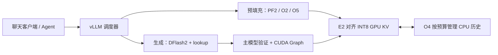

# QwenRelay

**在单张、双张或四张 RTX 3090 上运行 Qwen3.8-27B：DFlash2 推测解码、长上下文预填充，以及可复用的会话缓存。**

[English](README.md) · [快速开始](#快速开始) · [实测表现](#实测表现) · [启动参数](#启动参数) · [文档导航](#文档导航)

QwenRelay 面向本地编程助手、多轮 Agent 和小并发推理服务。项目基于固定版本的 [HyperQwen](https://github.com/syv-ai/HyperQwen) 与 vLLM，补充 INT8 KV 存储、按预算管理的 CPU 历史缓存、Prefill 优化和推测解码的 CUDA Graph 修复。

从 **一张 RTX 3090 24 GB** 即可开始部署。启动器默认选择 **TP1 + AutoRound-fast + DFlash2**，允许四条请求同时运行；`--tp 2`、`--tp 4` 切换为 EfficientThink 和对应的资源、优化配置。并发、上下文、草稿深度和缓存预算均可手动覆盖。

> **当前为源码候选版本：** 历史 TP1、TP2、TP4 实现已有不同范围的 GPU 实测；当前统一源码完成离线重建和 CPU 检查。合并版本的全新安装、完整公开权重准备、Docker 启动和 GPU 回归仍待验证。具体范围见[验证状态](#验证状态)。

## 项目解决什么问题

编程助手会反复发送不断增长的历史，多位用户也可能同时提交长提示词与持续生成请求。QwenRelay 重点优化这些场景中的内存使用与执行路径：

| 能力 | 对使用者的意义 |
|---|---|
| **DFlash2 推测解码** | 草稿模型提出候选，由主模型验证；启动器同时启用上下文 lookup 辅助草稿和 split-KV 验证 Attention。 |
| **长上下文预填充** | 在符合条件的 Prefill 中复用 INT8 KV，覆盖单请求与混合预填充批次。 |
| **会话缓存复用** | 结合 GPU 前缀缓存与 CPU 历史缓存，保留完整 Attention KV、循环状态和草稿历史。 |
| **小并发服务** | 默认最多四路运行请求；根据实际并发和草稿深度分配验证工作区、设置 CUDA Graph 覆盖范围。 |
| **单卡、双卡、四卡统一入口** | 自动选择匹配的权重、显卡布局、缓存预算与草稿配置，也允许显式调参。 |
| **OpenAI 兼容接口** | 提供 Chat Completions 和 SSE 流式输出，预配置 Qwen 推理与工具调用解析器。 |
| **可追溯的源码和权重** | 固定上游提交、模型版本及最终文件哈希，保留原作者归属与第三方说明。 |

当前启动器面向 **原生 Linux、RTX 3090 24 GB，以及锁定的 Qwen3.8-27B 文本模型**。其他显卡、任意替换权重和视觉输入尚不在这些配置范围内。客户端可以提交更多排队请求，但默认调度器最多同时运行四条。

## 实测表现

以下为**历史同条件 H/F 对测**，不是最新合并代码的性能认证，也不是与当前上游最新版的排行榜。每组对测内，H 为当时的 HyperQwen 参考实现，F 为 QwenRelay 候选；两臂使用相同模型资产和硬件，各执行一轮预热、三轮正式测试，表中为正式轮中位数。

### 单张 RTX 3090 · TP1 · AutoRound-fast

同一张 GPU，6 GiB GPU KV、32 GiB CPU KV、四路运行请求、DFlash 深度 4。2026-10-19/20 的这轮对测中，**H、F 均补齐 DFlash 环境开关与 scratch 容量修复**。

| 场景 | 指标 | H | F | 变化 |
|---|---|---:|---:|---:|
| 真实问题 C1，默认采样 | C / 平均 TPOT，tok/s | 124.64 | **128.72** | +3.27% |
| 真实问题 C4，默认采样 | C / 平均 TPOT，tok/s | 162.09 | **324.65** | +100.29% |
| 真实问题 C4，temperature=0 | C / 平均 TPOT，tok/s | 164.17 | **330.76** | +101.48% |
| 64K 输入，C1 Prefill | 输入 tok/s | 562.93 | **1,041.40** | +85.00% |
| 100K 输入，C1 Prefill | 输入 tok/s | 423.01 | **925.88** | +118.88% |
| 128K 输入，C1 生成 | C / 平均 TPOT，tok/s | 91.88 | **138.68** | +50.95% |

30 项中，F 有 29 项中位数更优，T0 C2 为 −1.46%。机器存在共享 CPU、内存资源；本轮未重跑质量电池或独立缓存恢复验收。见[完整 30 项摘要与测试范围](docs/qwenrelay-tp1-benchmarks.md)。

### 双张 RTX 3090 · TP2 · EfficientThink

2026-10-17/18 的对测使用相同的 EfficientThink 混合 AWQ 主模型、DFlash2 草稿、原生运行库和缓存字节预算。

| 场景 | 指标 | H | F | 变化 |
|---|---|---:|---:|---:|
| 真实问题 C4，默认采样 | C / 平均 TPOT，tok/s | 107.50 | **360.11** | +235.00% |
| 真实问题 C4，temperature=0 | C / 平均 TPOT，tok/s | 113.19 | **374.92** | +231.22% |
| 64K 输入，C1 Prefill | 输入 tok/s | 887.74 | **1,418.95** | +59.84% |
| 100K 输入，C1 Prefill | 输入 tok/s | 698.48 | **1,308.30** | +87.31% |

原 22 项中也有回退：T0 C2 −2.63%、默认采样 C1 −1.85%；补充的 1K C1 合成 Decode 数据波动较大。见[完整双卡结果、范围与机器可读数据](docs/qwenrelay-benchmarks.md)。

**看数字时要同时看指标。** `C / 平均 TPOT` 反映请求生成阶段的时间，不等于整个任务的总输出吞吐。例如，双卡默认采样 C4 按完整测试时长计算的总输出吞吐为 **101.78 → 300.05 tok/s**。Prefill 则是输入 token 数除以完整测试时长。C8/C16 在四路调度上限下可能包含排队。

单双卡使用不同权重和机器，不能据此计算显卡扩展效率。四卡另有[数值与服务验证](docs/qwenrelay-tp4-validation.md)、[通信测试](docs/qwenrelay-tp4-communication-tuning.md)和[贪心输出调查](docs/qwenrelay-tp4-greedy-correctness.md)，这些有限测试不等同于三轮完整 TP4 H/F 矩阵。

## 选择显卡配置

`TP` 是张量并行：把同一个模型分到指定显卡上。TP2、TP4 分别由两张、四张卡共同执行一个模型，并不是独立的两份、四份 API 实例。

| 配置 | TP1：默认 | TP2 | TP4 |
|---|---|---|---|
| 显卡 | 1 × RTX 3090 24 GB | 2 × RTX 3090 24 GB | 4 × RTX 3090 24 GB |
| 主模型 | AutoRound-fast | EfficientThink SimPO 混合 AWQ | 同 TP2 |
| Profile | `single-3090` | `dual-3090` | `quad-3090` |
| 单请求上下文上限，含输入与输出 | 132,096 tokens | 262,144 tokens | 262,144 tokens |
| **每张卡** GPU KV 预算 | 6 GiB | 11,184,101,204 bytes，约 10.42 GiB | 14 GiB |
| **整个 TP 组** CPU KV 预算 | 32 GiB | 32 GiB | 32 GiB |
| 默认设备 | `0` | `0,1` | `0,1,2,3` |

三套配置均使用 **DFlash2 W4A16、草稿深度 4、最多四路运行序列、单步 2,048 tokens 调度预算、BF16 激活、INT8 per-token/head KV 和 FP16 循环状态**。草稿 TP 与主模型 TP 一致。

上下文上限是单请求限制。四个运行槽位不代表能同时容纳四条最长会话；权重、KV 池、工作缓冲区和 CUDA Graph 都要占用资源。多卡性能还受 PCIe/NVLink 拓扑、P2P 可用性、CPU 亲和性及散热影响，增加卡数并不保证降低延迟。

## 快速开始

### 1. 准备机器

| 项目 | 目标环境或规划建议 |
|---|---|
| 系统与 Python | 原生 Linux x86-64，Python 3.12，包含 `venv` 与开发头文件 |
| 显卡 | 单张、双张或四张 RTX 3090 24 GB |
| 驱动 | 兼容 CUDA 13.0 用户态；已有对测使用 NVIDIA 580.126.20 |
| 固定运行库 | vLLM 0.31.0、PyTorch 2.13.0、Triton 3.7.1，见[直接依赖](requirements-qwenrelay.txt) |
| 构建工具 | Git、GNU `patch`、C/C++ 编译器、curl 与 CA 证书 |
| 主机内存 | 默认 32 GiB CPU 缓存时，建议至少预留 64 GiB 可用内存；编译时再留余量 |
| 磁盘 | 一套模型路线、运行库、源码和缓存约预留 60 GiB；同时保留两套主模型或准备中间文件时增加空间 |
| Docker 额外要求 | Docker Compose 与已配置的 NVIDIA Container Toolkit |

内存、磁盘是规划建议，不是测得的最低门槛。macOS 可以阅读源码、运行离线检查，但无法运行这些 CUDA 服务配置。详细准备步骤见[中文安装文档](docs/qwenrelay-install.zh-CN.md)。

### 2. 安装固定运行库

```bash
git clone https://github.com/Stanley2Data/QwenRelay.git
cd QwenRelay
bash scripts/install-qwenrelay.sh
```

脚本创建**全新的 `.venv`**，安装依赖、获取固定版本 vLLM 并重建 QwenRelay 源码。已有环境会被拒绝。下载模型和启动服务是后续独立步骤。

### 3. 准备权重

```bash
# 默认单卡：AutoRound-fast 主模型与共用的 DFlash2 草稿。
.venv/bin/python scripts/qwenrelay.py fetch-models --root ./models

# 使用双卡或四卡时改用此命令；两者共用 EfficientThink 资产。
.venv/bin/python scripts/qwenrelay.py fetch-models --tp 2 --root ./models
```

执行你需要的配置所对应的命令。TP1 从固定版本的 HyperQwen 公开输入组装，在 CPU 上量化 embedding，再检查每个最终文件的哈希；已有模型目录只校验、不重写。具体来源见[模型权重](#模型权重)。

### 4. 创建密钥并启动

```bash
# 在仓库目录下创建一次。
umask 077
.venv/bin/python -c 'import secrets; print(secrets.token_urlsafe(32))' > api_key.txt

# 先查看配置：不读取密钥、不加载模型、不探测 CUDA。
bash scripts/start-qwenrelay.sh --tp 1 --devices 0 --dry-run

# 在前台启动服务。
bash scripts/start-qwenrelay.sh --tp 1 --devices 0
```

准备好对应权重后，双卡或四卡选择下列启动命令之一：

```bash
bash scripts/start-qwenrelay.sh --tp 2 --devices 0,1
bash scripts/start-qwenrelay.sh --tp 4 --devices 0,1,2,3
```

真实启动先校验模型哈希、运行库身份和可见 GPU。大文件哈希检查与首次编译可能需要一定时间。`--dry-run` 成功只表示启动计划生成成功。

### 5. 发起第一条请求

在另一个终端进入仓库目录：

```bash
export QWENRELAY_API_KEY="$(cat api_key.txt)"

curl --fail-with-body http://127.0.0.1:18020/v1/models \
  -H "Authorization: Bearer $QWENRELAY_API_KEY"

curl --fail-with-body http://127.0.0.1:18020/v1/chat/completions \
  -H "Authorization: Bearer $QWENRELAY_API_KEY" \
  -H 'Content-Type: application/json' \
  -d '{
    "model": "qwenrelay",
    "messages": [{"role": "user", "content": "用三句话解释 Prefill 和 Decode。"}],
    "max_tokens": 256,
    "temperature": 0.6,
    "chat_template_kwargs": {"enable_thinking": false}
  }'
```

这个短示例关闭 thinking，让较小的输出预算用于正文。需要流式输出时，在 JSON 中添加 `"stream": true`，并给 `curl` 加上 `-N`。

## 接入客户端与 Agent

| 客户端设置 | 填写内容 |
|---|---|
| 服务类型 | OpenAI-compatible Chat Completions |
| Base URL | `http://127.0.0.1:18020/v1` |
| 模型 ID | `qwenrelay` |
| API key | `api_key.txt` 的内容 |
| 上下文限制 | 对齐实际 `--max-model-len`，并为输出预留空间 |

Python 客户端可以在自己的环境安装 `openai` 包后调用：

```python
from pathlib import Path
from openai import OpenAI

client = OpenAI(
    base_url="http://127.0.0.1:18020/v1",
    api_key=Path("api_key.txt").read_text().strip(),
    timeout=600.0,
)
response = client.chat.completions.create(
    model="qwenrelay",
    messages=[{"role": "user", "content": "写一个合并两个有序列表的 Python 函数。"}],
    max_tokens=512,
    extra_body={"chat_template_kwargs": {"enable_thinking": False}},
)
print(response.choices[0].message.content)
```

配置默认启用 `qwen3` 推理解析器、`qwen3_coder` 工具调用解析器和自动工具选择。客户端通过 Chat Completions 的 `tools` / `tool_choice` 字段传入工具；收到工具调用后，由客户端执行，并在下一轮提交工具结果。具体 Agent 和结构化输出的端到端兼容性仍需分别验证。

多轮对话时，在 `messages` 中发送完整历史，尽量保持可复用前缀稳定。匹配的状态仍被保留时，缓存会自动复用；这些缓存位于进程内存，服务重启后不会持久保留。需要从另一台机器访问原生服务时，用 `--host` 指定可访问的绑定地址，并在客户端填写对应服务器地址。默认只监听本机。

## 启动参数

**生效顺序：** TP/profile 默认值 → 显式启动参数 → 最终运行配置。显式参数不会改写 JSON 文件，也不会改变 TP 选定的权重；最终 profile 环境会覆盖父 Shell 的同名变量。

| 参数 | 默认值或作用 |
|---|---|
| `--tp 1\|2\|4` | 默认 `1`，选择主模型和资源配置 |
| `--profile NAME` | `single-3090`、`dual-3090`、`quad-3090`；与 `--tp` 同时传入时必须匹配 |
| `--devices 0,1` | 优先使用已 export 的 `CUDA_VISIBLE_DEVICES`，否则使用配置对应的设备列表；数量必须匹配 TP |
| `--models-root PATH` | 默认仓库内 `./models`，也可 export `MODELS_ROOT` |
| `--max-num-seqs N` / `--concurrency N` | 默认 `4`，最大运行请求数，正整数 |
| `--max-model-len N` / `--context-length N` | 默认按 TP 选择，每请求输入与输出合计的 token 上限 |
| `--draft-tokens K` / `--num-speculative-tokens K` | 默认 `4`，允许 `1–63` |
| `--kv-cache-memory SIZE` | **每张卡** GPU KV 预算，接受整数 bytes 或 `5GiB`、`512MiB`、`3.5GiB` 等 IEC 单位 |
| `--kv-offloading-size GIB` / `--cpu-kv-gib GIB` | 默认 `32`，按**整个 TP 组**计算；`0` 关闭 CPU 卸载与 O4 |
| `--max-num-batched-tokens N` | 默认 `2048`，每个调度步的总 token 预算 |
| `--host ADDRESS` | 默认 `127.0.0.1`，也可 export `BIND_HOST` |
| `--port PORT` | 默认 `18020`，也可 export `PORT` |
| `--api-key-file PATH` | 默认仓库内 `api_key.txt`，也可 export `API_KEY_FILE` |
| `--dry-run` | 打印所选配置、覆盖项、有效设置、环境变量与 vLLM 参数 |
| `--help` | 查看当前入口的完整帮助 |

例如，查看单卡两路并发、64K 总上下文、草稿深度 6，以及更小缓存预算的启动计划：

```bash
bash scripts/start-qwenrelay.sh --tp 1 \
  --concurrency 2 --context-length 65536 --draft-tokens 6 \
  --kv-cache-memory 5GiB --cpu-kv-gib 16 --dry-run
```

也可以关闭主机卸载，同时保留 GPU 前缀缓存：

```bash
bash scripts/start-qwenrelay.sh --tp 1 --cpu-kv-gib 0 --dry-run
```

核对计划后移除 `--dry-run` 才会启动。修改配置后需要检查实际容量和性能。GPU 预算不接受含义不明确的 `5G` / `5GB`。原生启动器使用参数或已 export 的变量，**不会读取 `.env`**；Docker Compose 才会读取它。

### DFlash 深度、QMAX 与 CUDA Graph

启动器自动注入全部三项性能开关。默认深度对应：

```ini
VLLM_SPEC_DECODE_ATTN=1
VLLM_SPEC_DECODE_ATTN_QMAX=5
VLLM_DFLASH2_LOOKUP=1
```

并发为 `C`、草稿深度为 `K` 时，自动计算：

```text
单请求逻辑 query 上限 = K + 1
CUDA Graph 捕获上限  = C × (K + 1)
默认                 = 4 × (4 + 1) = 20 tokens
```

调度 token 预算必须覆盖这个乘积。Graph20 用来覆盖固定四路请求的验证形状，**不是** KV 缓存容量，也不保证每步输出 20 个 token。实际 scratch 可能按 kernel tile 向上取整；调大深度也不会改变草稿模型训练时的块长度。

早期独立入口曾漏掉这些 DFlash 设置，导致长上下文性能下降。直接启动修补后的 vLLM 时，需要同时保留这些开关与推测模型配置。具体用途、核对方式及 systemd 示例见 [DFlash 启动说明](docs/qwenrelay-install.zh-CN.md#dflash-启动开关)。

## 优化如何配合



| 部分 | QwenRelay 的改动 | 适用范围 |
|---|---|---|
| **E2：KV 布局** | INT8 KV head 按 16 字节对齐，适配混合 Attention / 循环状态页布局。 | 相同字节预算下，物理 padding 会影响可容纳 token 数。 |
| **O4：主机历史缓存** | 为完整 Attention、循环状态和草稿历史分配字节预算，修复对齐交接与 CPU 缓存恢复。 | 在设定主机预算内复用被保留的历史。 |
| **PF2 / O2 / O5：预填充** | 在符合条件的提示词形状中复用 INT8 KV 与有界工作区，包括混合预填充。 | TP1 24Q/4KV、TP2 12Q/2KV、TP4 6Q/1KV；不符合条件时原生回退。 |
| **Graph 覆盖** | 修复固定四路主模型/草稿的捕获路径，保留编译缓存身份与缓冲区生命周期约束。 | 默认上限 20，随并发和深度重算。 |
| **Attention 临时缓冲区** | 模型加载时按真实调度容量预分配。 | 避免实际仅四路，却因读不到配置而回退到按 256 路分配。 |
| **TP1 草稿输出头初始化** | 在确认共享主模型输出头前，避免临时分配完整词表输出头。 | 仅 TP1 显式启用，加载时检查最终共享关系。 |

O5 当前优化最多四条请求、2,048 个 query tokens 的合格 Prefill 批次。TP1 将四个 KV heads 分成两组处理，复用有界 arena；调大并发或批预算后可能走原生回退。Prefill 优化本身不能解释纯 Decode 加速。

底层服务补丁、模型准备和推测解码工作来自 HyperQwen。QwenRelay 的增量与源码身份见 [UPSTREAM.md](UPSTREAM.md)、[本地补丁](patches/qwenrelay)和[源码锁](locks/source.json)。O4 的设计沿革包含 [1Cat 缓存工作](THIRD_PARTY_NOTICES.md)。

## 模型权重

| 用途 | 固定公开来源 | 本地模型目录 |
|---|---|---|
| TP1 主模型 | [dbirks AutoRound 基础模型](https://huggingface.co/dbirks/Qwen3.8-27B-W4A16-AutoRound/tree/1f05c441c4e64ae0549de44fa9ea5a6d43610314) + [syvai fast 组件](https://huggingface.co/syvai/qwen3.8-27b-3090-fast-variant/tree/124c14e7e8c7d2f5402933b9af368e772a9fcf0c) + CPU embedding 准备 | `Qwen3.8-27B-W4A16-AutoRound-fast` |
| TP2 / TP4 主模型 | [nerkyor EfficientThink SimPO，AWQ-W4A16](https://huggingface.co/nerkyor/Qwen3.8-27B-EfficientThink-Uncensored-K3-Opus5-Grok4.6-GPT5.6Sol-SFT-SimPO-DFlash2/tree/882e1af3b8f5844f3b3163b132e343c06e91908f/NVFP4/AWQ-W4A16) | `Qwen3.8-27B-EfficientThink-AWQ-W4A16` |
| 共用草稿 | [syvai DFlash2 W4A16](https://huggingface.co/syvai/Qwen3.8-27B-DFlash2-W4A16/tree/4d30ec736ffc6b8688dc2ae2b502d9b48bdec279) | `Qwen3.8-27B-DFlash2-W4A16` |

将所选主模型和草稿目录放在同一个 models 根目录下，两套主模型可以共存。[TP1 权重锁](locks/models-tp1.json)与[TP2/TP4 权重锁](locks/models.json)记录最终文件大小和 SHA256；Git 不包含模型张量。EfficientThink 使用 W4/W8 混合权重与 BF16 激活，草稿保持 W4A16。

已有资产可以单独校验：

```bash
.venv/bin/python scripts/qwenrelay.py check-models --tp 1 --root ./models
# EfficientThink 使用 --tp 2 或 --tp 4。
```

## Docker 部署

仓库提供使用同一启动器和配置的**本地构建方案**。先准备模型资产与 `api_key.txt`，再执行：

```bash
cp .env.example .env
# 编辑 .env，将 MODEL_ASSET_DIR 设为主机模型目录的绝对路径。
# 单卡：TP=1，CUDA_VISIBLE_DEVICES=0
# 双卡：TP=2，CUDA_VISIBLE_DEVICES=0,1
# 四卡：TP=4，CUDA_VISIBLE_DEVICES=0,1,2,3
docker compose build
docker compose up -d
docker compose logs -f qwenrelay
```

Compose 将权重只读挂载、key 作为 secret 挂载，使用独立卷保留编译缓存，并配置 40 GiB 共享内存。主机 API 端口绑定到 `127.0.0.1`。需要覆盖调参项时，修改服务的 `command` 列表并重新创建容器。

当前没有 QwenRelay 预构建镜像，这份构建方案的全新构建与 GPU 启动仍待验证。见 [Docker 详细说明](docs/qwenrelay-install.zh-CN.md#docker)。

## 验证状态

| 证据 | 已验证的范围 |
|---|---|
| **当前合并源码** | 22 项 CPU 测试通过；完整重建核对 3,208 份源码、54 项继承补丁、3 项本地基础补丁与 15 份最终覆盖文件。覆盖配置、身份和 CPU 上的分配/分派行为。 |
| **历史 TP1** | AutoRound-fast，同一 GPU 的 30 项性能对测，每项一轮预热、三轮正式测试。 |
| **历史 TP2** | 32 项性能矩阵、四请求 Graph 捕获/回放观察，以及独立的 30 请求修复后缓存验收。性能矩阵自身的 CPU→GPU 恢复字节为零。 |
| **历史 TP4** | 23 项数值 GPU 检查、有限预热服务测试、通信对照和定向贪心输出调查。 |
| **合并版本待完成** | 从公开输入完整准备权重、全新原生/Docker 部署、TP1/TP2/TP4 数值与服务回归、质量、缓存恢复和更长时间稳定性测试。 |

详见[验证边界](docs/qwenrelay-validation.md)和[机器可读合并检查](docs/qwenrelay-tp-merge-validation.json)。[离线 CI](.github/workflows/qwenrelay-offline.yml)运行源码重建与 CPU 检查，不执行 GPU 推理或发布镜像。

## 常见问题

**有 CPU 缓存，是否整个会话都不需要 GPU 显存了？**

CPU 层保存可复用历史，活跃计算仍需要 GPU 资源。缓存未命中或被淘汰后可能需要重算；增加 CPU KV 不会自动提高 `--max-model-len`。

**四卡会自动打开 P2P，或者比双卡快一倍吗？**

TP 参数选择模型切分与默认配置，P2P 是否可用取决于硬件、驱动和拓扑。已有租用机器无可用 P2P，采用主机内存通信；当时的 NCCL 调优保留为特定机器的可选方案。

**为什么看似兼容的模型目录或运行库会被拒绝？**

启动会核对精确文件身份。检查所选 TP，运行 `check-models` / `check-runtime`，使用对应的资产和安装版本。把另一套权重重命名为预期目录，并不会使它匹配。

**显存不足时该调哪个参数？**

先查看有效配置和其他 GPU 占用。GPU KV、并发、草稿深度都会影响显存；CPU KV 消耗主机内存。按不足的资源降低预算或需求，仅调低上下文上限不会缩小已经固定的 GPU KV 预算。

**为什么改了 `.env` 没生效？**

原生脚本不读取它，应传参数或 export 支持的变量。Compose 读取 `.env`，修改后需要重新创建服务。

**为什么 temperature=0，换并发或 NCCL 设置后文本仍可能不同？**

BF16 归约顺序和执行路径变化可能让分数接近的 token 交换排名。temperature=0 不保证不同配置之间逐 token 一致。[TP4 调查记录](docs/qwenrelay-tp4-greedy-correctness.md)说明了已做的对照与结论范围。

## 开发与复现

```bash
python3 scripts/qwenrelay.py check-pack
python3 -m unittest discover -s tests -v

# 需要固定版本的干净 vLLM 源码、GNU patch，以及全新的输出目录。
python3 scripts/qwenrelay.py rebuild \
  --vllm-source /path/to/pristine-vllm --target /new/path/final-F
```

性能复现先查看公开测试驱动的计划，再对已经启动的服务运行：

```bash
python3 scripts/benchmark-qwenrelay.py --plan

# TP1 示例：完整矩阵必须符合你的服务容量与测试计划后再执行。
.venv/bin/python scripts/benchmark-qwenrelay.py --run \
  --tokenizer ./models/Qwen3.8-27B-W4A16-AutoRound-fast \
  --output ./bench/results/tp1-local-01
```

驱动运行原 22 项加十项上下文 Decode，包含长上下文 C4，不负责服务启停。它默认的 tokenizer 路径为 EfficientThink，TP1 需显式传入上面的路径。历史单卡对测跳过了 64K/128K C4 Decode，与此完整矩阵不同。结果请选择新目录并保留原始数据。

后续发布工作包括全新安装验收、三套 TP 配置的合并 GPU 回归，以及可重复的质量、缓存和稳定性证据。新增显卡或权重需附对应实测。提交复现问题时，请包含 commit、GPU/拓扑、驱动、模型身份、有效启动计划、实际 token 长度和指标定义。[参与贡献](CONTRIBUTING.md) · [提交 Issue](https://github.com/Stanley2Data/QwenRelay/issues)。

## 文档导航

| 主题 | 文档 |
|---|---|
| 安装、权重准备、Docker | [中文](docs/qwenrelay-install.zh-CN.md) · [English](docs/qwenrelay-install.md) |
| TP 默认值、覆盖参数与源码合并 | [TP 配置说明](docs/qwenrelay-tp-profiles.md) |
| 单卡性能 | [TP1 完整 30 项摘要](docs/qwenrelay-tp1-benchmarks.md) |
| 双卡性能与指标定义 | [TP2 对测报告](docs/qwenrelay-benchmarks.md) |
| 四卡验证与拓扑 | [TP4 验证](docs/qwenrelay-tp4-validation.md) · [NCCL 调优](docs/qwenrelay-tp4-communication-tuning.md) |
| 输出复现 | [TP4 贪心输出调查](docs/qwenrelay-tp4-greedy-correctness.md) |
| 发布证据与待办 | [验证边界](docs/qwenrelay-validation.md) |
| 源码归属与资产身份 | [UPSTREAM](UPSTREAM.md) · [源码锁](locks/source.json) · [模型锁](locks) |

`config/` 存放启动默认值，`scripts/` 提供 QwenRelay 入口，`extensions/final/` 保存最终源码覆盖层，`patches/qwenrelay/` 保存本地增量。[HyperQwen 原始 README](README.hyperqwen.md)、旧启动脚本与继承文档保留用于归属和开发追溯；本发行版的使用方式以上述 QwenRelay 文档为准。

## 致谢与许可

QwenRelay 基于 [HyperQwen](https://github.com/syv-ai/HyperQwen)、[vLLM](https://github.com/vllm-project/vllm) 和 [KVarN](https://github.com/huawei-csl/KVarN)，O4 缓存设计参考了 [1Cat-vLLM](https://github.com/1CatAI/1Cat-vLLM) 的工作。模型作者和固定聊天模板作者见[第三方说明](THIRD_PARTY_NOTICES.md)。

项目源码采用 [Apache-2.0](LICENSE)。权重与依赖分别遵循各自许可；原始作者声明和上游 Git 历史均保留。
